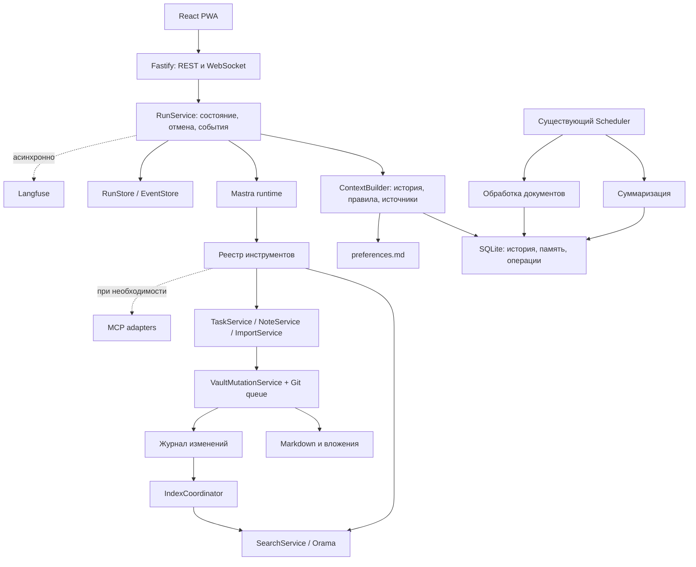

**План внедрения агентской среды: заметки, задачи, поиск и память**

Дата: 17 октября 2026 года. Основание: чтение текущего кода, обсуждённый выбор технологий и документация проектов. Исходная ревизия: `124fd2e`.

Исходный статус: план работ; при подготовке плана реализация и нагрузочные замеры не выполнялись. Обновление 17 октября: реализованы первые три пользовательских пункта (этапы 0–2 ниже); фактические изменения, проверки, измерения и ограничения описаны в [отчёте](agent-platform-stage-1-3.ru.md). Численные показатели в этом плане остаются предлагаемыми критериями приёмки; реальные результаты приведены отдельно. Исторический чеклист сохранён для сопоставления с реализацией.

**1. Результат, который должен получить пользователь**

Обновление 19 октября: реализация пунктов 4–5 описана в [streaming/Mastra](agent-platform-stage-4-5.ru.md),
6–8 — в [памяти, интерфейсе и документах](agent-platform-stage-6-8.ru.md),
9–10 — в [диагностике и MCP](agent-platform-stage-9-10.ru.md). Отчёты отделяют
локально проверенную реализацию от подключения облачных сервисов и выпуска на VPS.

Приложение быстро находит материалы в хранилище, отвечает со ссылками на конкретные фрагменты, создаёт и изменяет заметки и задачи через проверяемые операции. Пользователь видит ход выполнения, может отменить запрос и восстановить его состояние после потери соединения. Долговременные предпочтения доступны в обычном Markdown-файле. Сложные документы обрабатываются в фоне и используются повторно.

Ускорение оценивается отдельно по времени до первого полезного текста, времени до сохранённого результата и общему времени операции. Сообщение «работаю» не считается полезным ответом.

| Компонент | Решение для первого выпуска |
|---|---|
| Mastra | Агентский цикл режима заметок; ограниченный сценарий извлечения задачи с существующей валидацией |
| Orama | Локальный полнотекстовый индекс на сервере, русский стеммер, фильтры, поиск по разделам |
| remark + существующий yaml | Единый разбор Markdown и frontmatter; поддержка особенностей Obsidian |
| Существующая SQLite | История, черновики, операции, фоновые задания, события, суммаризации и производные проекции |
| Markdown-память | `System/Assistant/preferences.md` в пользовательском vault |
| lru-cache | Ограниченные кеши разобранных документов и поисковых результатов |
| Promptfoo | Проверка реального приложения через тестовый адаптер, сравнение вариантов |
| Langfuse | Асинхронная диагностика; по умолчанию метаданные без содержимого заметок |
| assistant-ui | Паттерны или совместимые компоненты отображения инструментов; существующая PWA сохраняется |
| MCP TypeScript SDK | Адаптер для конкретной внешней интеграции после стабилизации внутренних инструментов |
| Документы | Развитие PDF.js/Tesseract/DOCX-обработчика; мультимодальный маршрут для сложных страниц |

Mastra поддерживает агентские вызовы и потоковую выдачу; Orama — полнотекстовый и гибридный поиск. Это возможности библиотек, а не обещание ускорения данного приложения. [Mastra](https://mastra.ai/docs/agents/overview), [Orama](https://github.com/oramasearch/orama).

В начальный объём не входят несколько взаимодействующих агентов, Redis, отдельная векторная база, полноценный порт MarkItDown, перенос всей PWA на другой UI, замена Git-обёртки и отдельная NLP-платформа. Гибридный поиск и MCP выделены в этапы с условиями подключения.

**2. Что подтверждено в исходном коде**

| Наблюдение | Место | Что делать |
|---|---|---|
| Перед обработкой сообщения ожидается `sync.pull()` | `packages/server/src/index.ts:413` | Измерить ожидание; разделить требования к свежести чтения и записи |
| Подготовка памяти вызывается до выполнения и с `force=true` после него | `index.ts:414,430`, `chat-memory.ts:36–56` | Вынести LLM-суммаризацию в сохраняемую фоновую задачу; сохранить проверку актуальности |
| Суммаризация может выполнить до четырёх последовательных пакетов за вызов | `packages/server/src/chat-memory.ts` | Ограничить работу одного задания и объединять повторные запросы на суммаризацию |
| Поиск перечисляет заметки и последовательно читает их содержимое | `packages/core/src/search.ts:62–111` | Заменить горячий путь поиска индексом Orama |
| `NoteIndex.refresh()` перечитывает файлы и пересоздаёт проекции; `tasks()` вызывает refresh | `packages/server/src/note-index.ts:19–39` | Инкрементальное обновление; выдача задач из актуализируемой проекции |
| Ответ модели полностью буферизуется транспортом, затем читается через `res.json()` | `provider-transport.ts:78–97`, `packages/core/src/llm.ts:58` | Сквозной streaming: транспорт → адаптер → runtime → события → PWA |
| Агент заметок допускает до восьми раундов; вызовы инструментов обрабатываются по очереди | `packages/core/src/agent.ts:198–257`, `chat-modes.ts:23` | Бюджеты шагов; ограниченный параллелизм только независимых чтений |
| WS уже передаёт sequence, но счётчик локален обработчику запроса | `packages/server/src/index.ts:361–367` | Сохраняемый курсор событий и восстановление без повторного запуска |
| PWA обрабатывает статусы и финальный результат; отдельного жизненного цикла ToolCall нет | `packages/app/src/screens/Chat.tsx`, `packages/core/src/types.ts:44–53` | Ввести структурированные события инструментов и промежуточный текст |
| Журнал запросов помечает завершение как completed и при обработанной ошибке | `request-ledger.ts:16`, `index.ts:432,438` | Разделить факт завершения и исход: success/failed/cancelled/partial |
| Контракт мультимодального сообщения содержит текст и изображения | `packages/core/src/types.ts:79` | PDF-возможность провайдера и отдельный маршрут документов |
| Лимит загрузки составляет 5 МБ | `packages/server/src/attachments.ts:8` | Согласовать большие PDF с транспортом, хранением, квотами и воркером |

Это подтверждённые ограничения и свойства реализации. Их вклад в реальную задержку пока не измерен. Не утверждать, что любой из пунктов объясняет всю медленную работу приложения.

Сохранить существующие `TaskService`, `VaultMutationService`, общую очередь Git/файлов, request ledger, контроль хешей, TTL истории, изоляцию устройств, проверку адресов провайдеров и leases/fencing фоновых работ.

**3. Архитектура и владельцы данных**

| Данные | Авторитетное хранилище | Поведение при потере |
|---|---|---|
| Сохранённые заметки, задачи, импортированные материалы | Vault + Git | Восстановление из резервной копии/Git с учётом неподтверждённых локальных изменений |
| Правила и предпочтения | Markdown-файл памяти | Восстановление версии файла |
| История, активные черновики, run state и суммаризации | SQLite в пределах политики хранения | Не восстанавливаются полностью из Markdown; нужна резервная копия |
| Журнал предотвращения повторных операций | Существующая служебная SQLite | Сохраняется независимо от удаления текстов чата |
| Поисковые и задачные проекции | Производные SQLite/Orama | Перестраиваются из доступных файлов |
| Кеши и временные индексы | RAM/служебный каталог вне vault | Безопасно пересоздаются |

В проекте уже есть основная БД и ChatStore. Не объединять их попутно с внедрением Mastra. Для переходов, затрагивающих обе БД, предусмотреть идемпотентное согласование и восстановление: транзакция одной SQLite не обеспечивает атомарность второй БД и файловой системы.

**4. Сквозные правила и контракты**

До внедрения runtime зафиксировать структуры в `packages/core/src/contracts.ts`; названия ниже — проектные, не готовая реализация.

| Контракт | Обязательные поля и смысл |
|---|---|
| RunContext | server-derived actor/device/workspace scope, chatId, requestId, runId, mode, providerId + version, model, referenceInstant, timezone, deadline, AbortSignal, budgets |
| RunSnapshot | state, outcome, lastSequence, partialText, toolCalls, artifacts, usage, structuredError, engineVersion |
| RunEvent | schemaVersion, runId, sequence, timestamp, type; toolCallId для событий инструмента |
| ToolSpec | name, input/output schema, allowedModes, read/write class, timeout, maxOutput, execution policy |
| ToolResult | status, bounded public output, source references, mutation receipts, retryability |
| SearchHit | noteId или fallback identity, path, headingPath, chunkId, contentHash, source positions, snippet, score, indexRevision |
| ContextSnapshot | memoryRevision, preferencesHash, source versions, message coverage, token budget, omitted sections |
| MutationReceipt | operationId, artifacts, content hashes, saved_local/committed/synced/conflict |

Состояния запуска: `accepted → running → succeeded | failed | cancelled | interrupted`. Отдельный outcome `partial` показывает, что часть действий уже сохранена. Ожидание уточнения задачи — состояние черновика `needs_input`; сам ответ с вопросом завершает текущий run. Состояния пользовательской задачи остаются отдельной моделью.

Правила выполнения:

- Авторизацию, scope и доступные инструменты определяет сервер; значения клиента или модели не расширяют права.
- Один requestId с тем же телом возвращает прежнее состояние. То же ID с другим телом возвращает конфликт.
- Повтор доставки событий не повторяет инструменты. После неопределённого исхода записи сначала проверяется mutation receipt.
- toolCallId нужен для UI; operationId для записи должен оставаться стабильным при восстановлении. Повторная генерация моделью не должна создавать новый эффект вместо старого.
- Перед записью проверяются актуальные права, режим и contentHash; модель не обходит TaskService обычным редактированием Markdown.
- Срок задачи берётся из конкретного сообщения пользователя. Сохраняются источник срока, referenceInstant и timezone; повтор завтра не сдвигает дедлайн.
- Отмена запрещает новые действия, прерывает поддерживающие AbortSignal операции и возвращает список уже сохранённых результатов. Автоматического отката успешных записей нет.
- В UI, логах и событиях хранятся результаты и краткие статусы, а не скрытые рассуждения модели.
- Удаление чата/истечение TTL увеличивает generation или эквивалентный маркер; запоздавший worker не восстанавливает удалённые данные.

**5. Этап 0 — исходные замеры и совместимость**

Зависимости: нет. Результат: воспроизводимая исходная точка и подтверждённый способ интеграции библиотек.

- [ ] Запустить существующие `npm test`, `npm run typecheck`, `npm run build`. Зафиксировать реальные ошибки отдельно от новых изменений.
- [ ] Подготовить синтетический vault без персональных данных: русский текст, aliases, frontmatter, задачи, ссылки, таблицы, код, формулы, ошибочные документы.
- [ ] Собрать 60–100 сценариев для первого набора: поиск, диалог, создание/изменение, уточнение сроков, повтор запроса, конфликт и документы.
- [ ] Ввести таймеры для auth/queue/sync/context/search/provider/tool/mutation/finalize. Сохранять число LLM-вызовов, размеры контекста, токены, исход и задержку event loop.
- [ ] Разделять provider first token, первый текст в браузере, первый полезный ответ и подтверждённую запись. Сравнивать p50/p95 на одной модели и одинаковых данных.
- [ ] Сделать небольшой тест совместимости Mastra с существующими профилями и защищённым transport: текст, инструмент, streaming, abort, ошибка. Новые библиотеки пока не меняют рабочий маршрут.
- [ ] Проверить `engines`/peerDependencies выбранных стабильных версий с Node, TypeScript и React 18 проекта; зафиксировать lockfile. Документация ветки main не заменяет проверку опубликованной версии.
- [ ] Проверить, можно ли использовать компоненты assistant-ui без отдельного обновления React и изменения backend-протокола. Если нет — реализовать нужные карточки на текущем React.
- [ ] Подключить минимальный Promptfoo harness к тестовому приложению. На этом этапе достаточно ключевых сценариев; расширять набор вместе с изменениями.

Приёмка: есть исходный отчёт с конфигурацией машины, корпусом, моделью, выборкой и сырыми измерениями без секретов. Не использовать данные работающего сервера как тестовые фикстуры без обезличивания.

**6. Этап 1 — убрать необязательное ожидание и закрепить исход операции**

Основные модули: `index.ts`, `chat-memory.ts`, `scheduler.ts`, `chat-store.ts`, `request-ledger.ts`, `sync.ts`, `vault-mutations.ts`.

**6.1. Память вне ожидания ответа**

- [ ] Разделить `inspect/readContext` и `summarize`: чтение готового контекста не вызывает модель.
- [ ] Сохранять последние реплики дословно в пределах бюджета; суммаризировать старый префикс. Не сворачивать принудительно весь свежий диалог после каждой реплики.
- [ ] После сохранения ответа фиксировать итог run и устойчивое намерение запустить summary job; затем отдавать результат. Согласование двух БД — через журнал/повторяемую recovery-процедуру.
- [ ] Добавить тип задания `summarize`, его собственную политику enabled/cancel/retention. Текущую логику Scheduler, различающую extract/organize/digest, расширить явно.
- [ ] Ключ задания включает scope, chatId, generation и границу сообщений; повторные изменения объединяются до актуальной границы.
- [ ] Проверять CAS по версии памяти, хешам покрытых сообщений и источников до применения summary. Сохранить существующие проверки coverage и stale sources.
- [ ] Срок summary не переживает самый ранний срок её исходных данных. Истечение/удаление сообщения инвалидирует зависимое резюме.
- [ ] Если summary отстаёт, использовать ограниченный свежий контекст с указанием пропуска; точное состояние задач читать структурированно.
- [ ] Чтение экрана «Память чата» сделать дешёвым; пересчёт — явная фоновая операция с состоянием.
- [ ] Развести приоритеты OCR, индексирования и суммаризации: длительный PDF не должен бесконечно задерживать память. Начать с ограниченной конкуренции по типам, измерить RAM/CPU.

**6.2. Свежесть Git без лишней блокировки чтения**

- [ ] Для запросов чтения использовать локальную проверенную ревизию и плановое обновление; возвращать время последней успешной синхронизации.
- [ ] Сохранить явное действие «обновить сейчас». Допуск устаревания — настраиваемая политика, стартовое предложение 30 секунд, затем проверить поведение на реальном workflow.
- [ ] Для мутаций сохранить строгую политику: синхронизация при необходимости, проверка хеша после неё и применение через общую очередь. Если pull изменил целевую заметку, вернуть конфликт, не переписать её старым результатом модели.
- [ ] Не держать общую очередь файлов во время LLM-вызова. План строится по снимку, короткая фаза применения проверяет актуальность.
- [ ] Добавить понятные состояния недоступного remote/конфликта и ограничение ожидания Git. Не считать проглоченную ошибку pull подтверждением свежести.
- [ ] Локальный contentHash не доказывает актуальность относительно remote; явно сохранить эту границу в API и тестах.

**6.3. Итог и ошибки**

- [ ] Отделить terminal state от outcome; корректно показать failed/cancelled/partial и подтверждённые artifacts.
- [ ] Завершать run до фоновой суммаризации; ошибка фоновой работы не меняет успешный пользовательский результат.
- [ ] Сохранять источник ошибки и retryability: провайдер, лимит, конфликт, недоступный файл, отмена. Не раскрывать тела upstream-ответов с личными данными.

Приёмка: искусственно медленная/сломанная суммаризация не задерживает финальный результат; повтор запроса после перезапуска не создаёт вторую заметку; отмена после записи показывает сохранённый файл; одновременное редактирование и pull не теряют данные. Проверки проходят и для нескольких доверенных устройств.

**7. Этап 2 — единый Markdown и инкрементальный поиск**

Основные модули: существующие `search.ts`, `note-index.ts`, `links.ts`, `task-document.ts`, `notes.ts`, `note-mode.ts`; новые `markdown-document.ts`, `search-service.ts`, `search-index.ts`, `index-coordinator.ts`.

**7.1. Разбор документа**

- [ ] Ввести один ParsedDocument: frontmatter, title, aliases, tags, AST, ссылки, разделы, source positions, contentHash.
- [ ] Использовать remark для структуры Markdown и существующий yaml для метаданных. Учесть GFM-таблицы, task lists, fenced code, математику, wikilinks, embeds, anchors и block IDs; нужные расширения подключить явно.
- [ ] Не нормализовать весь файл через stringify при обычной индексации. Запись должна сохранять неизвестные YAML-поля и не менять лишние блоки.
- [ ] Невалидный YAML отображать как ошибку документа. Разделить допустимое текстовое чтение и запрет автоматической правки повреждённых метаданных.
- [ ] Не добавлять ID во все файлы только ради поиска. Использовать существующий noteId; fallback identity и переименование обрабатывать без скрытой модификации vault.
- [ ] Нарезать по иерархии заголовков, большие разделы по абзацам. Таблицы/формулы/код не разрывать случайно; слишком большой атомарный блок помечать и читать отдельно с лимитом.
- [ ] Начальные размеры фрагмента подобрать на фикстурах; ориентир для эксперимента 400–800 токенов, а не жёсткое обещание оптимальности. Учитывать заголовки и метаданные в бюджете.
- [ ] Ссылки ответа ведут к исходной заметке/странице, а не к внутреннему ID Orama.

remark даёт структуру документа; поведение Obsidian требует собственных расширений и тестов. Код Smart Connections не копировать в этот этап: использовать независимо реализованные принципы и отдельно проверять лицензию выбранных исходников. [remark](https://github.com/remarkjs/remark), [Smart Connections](https://github.com/brianpetro/obsidian-smart-connections).

**7.2. Индекс**

- [ ] Orama хранит chunks и поля noteId/path/title/headingPath/body/tags/aliases/type/category; поля дат и идентификаторов сохраняют точное значение.
- [ ] Подключить совместимый русский tokenizer/stemmer; одинаково обрабатывать запрос и документ. Проверить `ё/е`, сохранение различия `й/и`, русско-английские названия и термины с дефисами.
- [ ] Реализовать веса полей, фильтры и группировку фрагментов по заметке; начальные веса выбирать по оценочному набору.
- [ ] SearchService становится единственной точкой поиска для агента, UI, связанных заметок и подбора карточек людей. Иначе старые полные сканирования останутся внутри записи.
- [ ] IndexCoordinator получает изменения от локальных мутаций, Git pull, импорта, rename/delete и внешних правок vault. Watcher использовать как подсказку, дополняя периодической сверкой.
- [ ] Сохранять журнал изменений/контрольную ревизию до подтверждения обработки; при аварии переигрывать его идемпотентно. Snapshot Orama имеет schemaVersion/chunkerVersion/tokenizerVersion и проверяется при загрузке.
- [ ] При стартовой перестройке создавать новую генерацию и атомарно переключать активную. Не выдавать наполовину собранный индекс.
- [ ] После записи обеспечить read-your-writes: дождаться нужной индексной ревизии либо временно читать записанные artifacts напрямую. UI не должен сообщать «сохранено», а поиск сразу «не найдено» без объяснения.
- [ ] Удалённые/запрещённые файлы немедленно скрывать из результатов, даже если фоновые обновления ещё не завершились. Проверять права перед выдачей snippet и перед чтением источника.
- [ ] Дубликаты noteId диагностировать без слияния чужих документов. Rename обновляет path и ссылки; contentHash определяет актуальность содержимого.
- [ ] Задачные проекции обновлять по изменениям, а не полной перестройкой при каждом GET.

**7.3. Кеши**

- [ ] Добавить lru-cache с ограничением памяти и числа записей; размер считать по фактическим данным, TTL использовать дополнительно.
- [ ] Ключ разбора: scope + contentHash + parserVersion. Ключ поиска: scope + accessPolicyVersion + indexRevision + query + filters + limit.
- [ ] Предусмотреть объединение одновременных одинаковых вычислений; отказ одного запроса не оставляет навечно pending-запись.
- [ ] Инвалидировать кеши при смене доступа, rename/delete, записи, pull и смене версии парсера. Кеш ответов модели и мутаций на этом этапе не добавлять.

Приёмка: поиск на подготовленном корпусе не перечитывает все файлы на каждый запрос; обновление одной заметки не перестраивает все проекции; удалённый/приватный документ отсутствует в snippets. На размеченных русских запросах релевантный источник попадает в top-5 не менее чем в 90% случаев — предварительная цель, уточняемая после baseline. [lru-cache](https://github.com/isaacs/node-lru-cache).

**8. Этап 3 — сохраняемые события и настоящий streaming**

Основные модули: `provider-transport.ts`, `llm.ts`, `native-llm.ts`, `types.ts`, `contracts.ts`, `index.ts`, `api.ts`, `Chat.tsx`; новые `run-service.ts`, `run-store.ts`, `run-events.ts`, UI reducer.

- [ ] Сначала зафиксировать независимый от Mastra контракт событий; существующий runtime временно также умеет его выдавать.
- [ ] Расширить защищённый transport потоковым Response body. Сохранить DNS/address policy, запрет неожиданных redirect, лимиты сжатых/распакованных данных и отмену.
- [ ] Не подменять transport обычным fetch из SDK в обход существующей политики. Проверить точный способ передачи transport в зафиксированной версии Mastra/провайдерного адаптера.
- [ ] Поддержать корректную разборку событий на границах TCP/UTF-8, ограничение кадра, backpressure, закрытие сокета, ошибку после HTTP headers и usage в конце потока.
- [ ] Разделить connection/first-byte/idle/total timeout; существующий общий бюджет остаётся верхней границей.
- [ ] Собрать аргументы tool call полностью и проверить схему до исполнения. Частичный JSON инструмента никогда не запускает запись.
- [ ] События: run.accepted, run.started, text.delta, tool.started, tool.completed, tool.failed, artifact.saved, run.completed, run.failed, run.cancelled.
- [ ] Sequence выделяется сервером в пределах run и сохраняется. REST и WS читают одну RunSnapshot; повтор сообщения не создаёт новый счётчик с побочными эффектами.
- [ ] Записывать критические события устойчиво до отправки. Текстовые дельты буферизовать небольшими пакетами; не делать SQLite-транзакцию на каждый токен.
- [ ] Reconnect передаёт lastSequence; сервер возвращает хвост событий либо snapshot с курсором. Клиент удаляет дубликаты, обнаруживает разрывы и не дописывает полный финальный текст поверх уже выведенного.
- [ ] После серверного restart незавершённый поток получает interrupted с подтверждёнными artifacts. Не обещать продолжение токен-в-токен без сохранённого checkpoint и поддержки провайдера.
- [ ] Разрыв WS сам по себе не отменяет операцию; пользовательская отмена — отдельное действие. Сохранить текущую проверку принадлежности чата/устройства.
- [ ] Старый клиент получает прежний финальный result. Новые поля вводятся совместимо с PWA, которая может жить со старым service worker.
- [ ] Для режима задач потоковый сырой JSON не показывать пользователю: статусы обработки и затем проверенный результат.

Приёмка: fake provider отправляет задержанные чанки, и PWA показывает текст до окончания ответа; дельты не теряются и не дублируются при reconnect; отмена закрывает provider stream; незавершённые tool args не исполняются. Повторяется для поддерживаемых адаптеров; неподдерживаемые честно работают без streaming.

**9. Этап 4 — Mastra и единый набор инструментов**

Зависимости: контракты run, поиск, безопасные мутации, провайдерный transport. Новые модули предполагаются в серверном пакете: `agent-runtime.ts`, `mastra-runtime.ts`, `tool-registry.ts`, `agent-context.ts`. Core сохраняет доменные контракты без обязательной зависимости UI от Mastra.

- [ ] Ввести интерфейс runtime и два адаптера: legacy и mastra. Конкретный engine фиксируется при создании run и не меняется в середине выполнения.
- [ ] Подключить Mastra внутри существующего Fastify. Не поднимать второй публичный сервер с отдельной авторизацией и памятью.
- [ ] Профили провайдеров и секреты остаются в ProviderRegistry; endpoint, модель, возможности и версия профиля фиксируются для run. Проверить, что SDK не выбирает случайный глобальный ключ из ENV вместо нужного профиля.
- [ ] Перенести инструменты через единый ToolSpec и серверную валидацию. Минимум: search_notes, read_note/read_section, create_note, append_note, update_note; операции задач через TaskService и существующую политику режимов.
- [ ] Сохранить быстрые `/quick`, `/idea`, `/person` там, где не нужна модель. Существующие task/note режимы не смешивать скрыто.
- [ ] Режим задачи оставить ограниченным извлечением структуры и применением валидированного изменения. Для известных шагов не запускать свободный многократный цикл.
- [ ] ContextBuilder объединяет правила приложения, явные предпочтения, свежие реплики, валидную summary, структурированное состояние черновика и выбранные источники. У каждого раздела свой бюджет.
- [ ] Не добавлять весь vault и все прошлые вложения в каждый запрос. Из вложений выбирать релевантные страницы/фрагменты, сохраняя возможность явно прочитать продолжение.
- [ ] Для заметок стартовый предел — 4 LLM-шага, до 6 только для выделенных сложных сценариев; значения экспериментальные, проверяются оценками. Есть общий deadline и лимит токенов/стоимости.
- [ ] Независимые read-only tools выполнять с небольшой конкуренцией, например 2. Записи сериализовать; read-after-write и зависимые инструменты ждут подтверждённой версии.
- [ ] После успешной операции по возможности формировать подтверждение из receipt, без дополнительного LLM-вызова только ради фразы «готово».
- [ ] У retries один владелец. Отключить вложенные повторы SDK/обёртки либо согласовать общий бюджет; выполнять backoff только для подходящих ошибок и с проверкой уже совершённых эффектов.
- [ ] Не включать параллельно Mastra Memory и текущую суммаризацию. На первом этапе контекст передаёт приложение; durable run state ведёт RunStore.
- [ ] Если позже понадобятся сохраняемые workflows Mastra, подключить поддерживаемый storage adapter и назначить владельца каждого состояния. Отдельная libSQL-БД не заменяет таблицы приложения автоматически.
- [ ] Shadow-сравнение разрешить только на чтении или изолированной копии vault; два runtime никогда не исполняют одну рабочую мутацию для сравнения.

Mastra имеет собственную систему памяти, требующую storage provider; её подключение — отдельное решение, а не обязательное условие первого переноса. [Mastra Memory](https://mastra.ai/docs/memory/overview).

Приёмка: каждый прежний пользовательский сценарий работает через выбранный runtime; исходы задач и мутаций совпадают на детерминированных фикстурах; cancellation/retry не создают дублей; число шагов и стоимость видны. Legacy остаётся временным fallback для новых запусков.

**10. Этап 5 — долговременные правила в Markdown**

Модули: `preferences-memory.ts`, ContextBuilder, NoteService/VaultMutationService, настройки и просмотр памяти в PWA.

- [ ] Зафиксировать путь `System/Assistant/preferences.md`, схему метаданных, версию и ограничение размера. Файл следует правилам доступа vault; наличие имени не делает его автоматически доверенным.
- [ ] Содержимое разделить на предпочтения общения, организацию хранилища и явно сохранённые рабочие правила. Не записывать историю диалогов и статусы задач в этот файл.
- [ ] Читать этот небольшой файл напрямую с проверкой хеша; исключить из обычных RAG-результатов и автоматической сортировки.
- [ ] Показать «Что запомнено», редактирование и удаление. Явная команда «запомни, что…» может применяться сразу; вывод модели из заметки без такой команды остаётся предложением.
- [ ] Для изменения использовать patch/полную проверенную версию, expectedHash и operationId. При конфликте внешнего редактирования сохранить обе версии для разрешения, не выбирать молча.
- [ ] Правила памяти не отменяют запрет доступа, проверки сроков, ограничения инструментов и явные текущие инструкции пользователя.
- [ ] Личные предпочтения из истёкшей истории не продлевают себе срок автоматически. Постоянным становится только явно сохранённое правило.
- [ ] Ошибочный/слишком большой файл даёт понятное предупреждение; агент работает с безопасной базовой конфигурацией. Не подставлять устаревший кеш после отзыва доступа.

Приёмка: предпочтение сохраняется между новыми чатами и перезапуском; удаление сразу влияет на следующий запрос; инструкция из PDF не попадает в память; конфликт редактирования не теряет пользовательский текст.

**11. Этап 6 — понятный ход работы в PWA**

Модули: `screens/Chat.tsx`, `api.ts`, новые `RunProgress`, `ToolCallCard`, `SourceList`, `PartialResult`; текущие стили и доступность сохраняются.

- [ ] Карточки инструментов показывают понятное действие, running/succeeded/failed/cancelled, длительность и ограниченный результат.
- [ ] Поиск показывает найденные источники; чтение — заголовок/раздел; запись — путь, локальный исход и отдельный статус Git-синхронизации.
- [ ] Не выводить API-ключи, полные аргументы с содержимым документов и технический stack trace. Подробности доступны в ограниченном диагностическом представлении.
- [ ] Промежуточный текст оформлять как продолжающийся ответ; успех мутации выводить по receipt.
- [ ] При частичном сбое показывать выполненное и невыполненное; повторяется только безопасная незавершённая часть, а не весь run с новым ID.
- [ ] Сохранить черновик ввода, режим, вложения и положение прокрутки при reconnect/смене экрана.
- [ ] Проверить 320/390/1440 px, клавиатуру, screen reader, reduced motion, длинные пути, таблицы и крупные блоки текста.
- [ ] Использовать assistant-ui через адаптер своего runtime, если spike подтвердил совместимость; иначе взять паттерн ToolCall и реализовать компоненты на текущем React.

assistant-ui допускает интеграцию с собственным backend/runtime и отображение вызовов инструментов. [Репозиторий](https://github.com/assistant-ui/assistant-ui).

Приёмка: пользователь понимает, что происходит, видит подтверждённые результаты после reconnect и может отменить работу; интерфейс не размножает сообщения и карточки.

**12. Этап 7 — документы без отдельного проекта-порта**

Модули: `attachments.ts`, `extraction.ts`, `extract-process.ts`, `extraction-jobs.ts`, `imports.ts`, capability/transport контракты и UI загрузки.

- [ ] Сохранить рабочие PDF.js, Tesseract и DOCX-маршруты. Mammoth/Turndown подключать только после сравнения качества нужных DOCX/HTML на фикстурах.
- [ ] Ввести DocumentExtraction: fileHash, extractorVersion, page/section, text, warnings, provenance, method (`native`, `ocr`, `model`) и статус частичной обработки.
- [ ] Разделить текстовые PDF, сканы и визуально сложные страницы. Не считать наличие текста доказательством, что диаграммы распознаны.
- [ ] Добавить возможности провайдера: native PDF input, image input, лимиты байтов/страниц/контекста. Возможность vision не включает PDF автоматически.
- [ ] При native PDF передавать файл поддерживаемым способом; иначе рендерить выбранные страницы в изображения. Для сложного документа разрешён отдельный фоновый разбор по пакетам страниц.
- [ ] Сохранять связь ответа со страницами и различать извлечённый текст и интерпретацию схемы моделью. Частичный результат не выдавать за обработку всех страниц.
- [ ] Кешировать извлечение по scope + fileHash + extractorVersion + modelVersion + settings. Временный документ и его производные удалять по тому же происхождению/TTL.
- [ ] Пересмотреть лимит 5 МБ комплексно: reverse proxy, Fastify parser, квота пользователя, SQLite BLOB/внешний файл, provider request limit, base64 overhead и память worker. Не повышать одну константу изолированно.
- [ ] Для больших оригиналов рассмотреть потоковую загрузку в временный каталог с авторизованным attachmentId; миграция существующих маленьких вложений не обязательна.
- [ ] Ограничить страницы, пиксели, распакованный DOCX, время, CPU и RAM; corrupted/encrypted PDF даёт понятный исход. Отмена/истечение TTL останавливает worker и очищает временные файлы.
- [ ] OCR и обработку страниц выполнять вне HTTP event loop с ограниченной конкуренцией. После перезапуска recovery использует существующие jobs и fencing.
- [ ] Отправлять в чат релевантные фрагменты и страницы. Повторный вопрос к тому же файлу не должен запускать OCR или передачу всего учебника заново без причины.

Приёмка: текстовый PDF, скан и PDF со схемой проходят разные проверенные маршруты; есть ссылки на страницы; повтор использует результат; большой документ не делает чат недоступным. Проверить реальный запрос к выбранному провайдеру на синтетическом PDF со схемой. Полноценный порт [MarkItDown](https://github.com/microsoft/markitdown) не требуется.

**13. Качество и диагностика на всех этапах**

**Promptfoo.** Адаптер вызывает реальный RunService/SearchService на изолированной БД и vault. Unit/integration-тесты проверяют переходы состояний и записи; Promptfoo — качество retrieval, ответов и выбор инструментов. LLM-оценка текста дополняет, а не заменяет строгие проверки. [Promptfoo](https://github.com/promptfoo/promptfoo).

| Группа | Обязательные проверки |
|---|---|
| Русский поиск | Склонения, aliases, ё/е, й/и, похожие названия, точные пути, запрос без результата, фильтры |
| Источники | Изменение/удаление/rename, дубликат ID, приватная папка, устаревшая ссылка из памяти |
| Задачи | Нет срока, неоднозначный срок, относительная дата после полуночи, несколько задач, повтор уточнения, конфликт версии |
| Мутации | Тот же requestId, другой payload, перезапуск после сохранения файла, потеря ответа, отмена после частичной записи |
| Streaming | Разбитый UTF-8/JSON, обрыв до/после tool call, reconnect, повтор события, snapshot вместо старого хвоста |
| Память | TTL, удаление во время summary, CAS, смена источника, одновременные предпочтения, инструкция из документа |
| Документы | Текст/скан/схема, повреждённый PDF, большой файл, отмена, квота, неполная обработка |
| Провайдеры | Нет tool calls/stream/PDF, 429/5xx, timeout, смена профиля во время run, невалидный вывод |

Быстрые детерминированные проверки запускать на каждый PR. Платные LLM-evals — контролируемый отдельный запуск и перед выпуском; фиксировать модель, настройки, promptVersion, корпус и лимит стоимости. Случаи с нестабильными результатами повторять и показывать разброс. Автоматическая оценка не должна изменять рабочий vault.

**Langfuse.** Добавить trace с requestId/runId, engine/provider/model version, длительностями этапов, количеством шагов, токенами, cache hit/miss, index lag и outcome. Первое подключение — после стабилизации span-контракта этапа 0. [Langfuse](https://github.com/langfuse/langfuse).

- [ ] По умолчанию без prompt/completion body, текста заметок, имён файлов и пользовательских названий чатов; для корреляции использовать непрозрачные ID.
- [ ] Sanitize выполнять до формирования/export trace, включая вложенные exceptions/tool args. Автоматический Mastra exporter проверить на скрытый захват содержимого.
- [ ] Экспорт асинхронный, очередь ограничена; недоступность диагностики не ломает чат. На shutdown — ограниченный flush.
- [ ] Retention трасс и режим подробной диагностики явные; подробные данные не переживают согласованную политику удаления.
- [ ] Размещение Langfuse решить по текущим ресурсам: управляемый сервис или отдельная инфраструктура. Не добавлять весь self-hosted стек на существующий VPS без проверки RAM/CPU/диска.
- [ ] Для нового выпуска сравнить p50/p95, errors, tokens, шаги, память процесса и event-loop lag с baseline. Трассировка не заменяет измерение на устройстве пользователя.

**14. Этап 8 — MCP при появлении конкретного сценария**

Зависимости: стабильный ToolSpec, auth scope, run state и error model.

- [ ] Сначала определить направление: приложение подключается к внешнему MCP-серверу или предоставляет свои инструменты внешнему клиенту. Это разные адаптеры.
- [ ] Для первого внедрения выбрать одну интеграцию с конкретной пользой и проверочным запросом. Установка SDK без работающего сценария не считается завершением.
- [ ] Внутренние сервисы продолжают вызываться напрямую. MCP-адаптер использует тот же ToolSpec и доменные сервисы.
- [ ] Внешний клиент получает ограниченный scope; внешние tool outputs считаются данными. Настроить auth, timeout, лимит результата и cancellation.
- [ ] Подключение пользовательского URL проходит проверку endpoint/DNS, защищающую от доступа к произвольным адресам сервера. Локальные разрешённые endpoints задаются явно.
- [ ] SDK и выбранный transport закрепить по стабильному релизу; API ветки main не переносить без проверки совместимости.
- [ ] Ошибка внешнего сервиса не запускает повтор внутренних записей. Для записи неизвестный исход требует проверки, а не слепого retry.

Приёмка: один реальный безопасный запрос проходит полный маршрут, права ограничены, timeout/cancel работают, результат виден в карточке инструмента. [MCP TypeScript SDK](https://github.com/modelcontextprotocol/typescript-sdk).

**15. Этап 9 — гибридный поиск по доказанной необходимости**

Условие начала: размеченные запросы показывают смысловые промахи полнотекстового поиска, которые не исправляются метаданными, aliases и настройкой ранжирования.

- [ ] Выбрать мультиязычную embedding-модель по русскому корпусу, цене и условиям обработки данных; выбор не фиксировать без сравнения.
- [ ] Генерировать embeddings в фоне по contentHash + chunkerVersion + embeddingModel/version/dimension. Не встраивать эту работу в сохранение заметки.
- [ ] Разные модели/размерности не смешивать в одном векторном поле. Перестройку делать новой генерацией с возможностью переключения назад.
- [ ] Объединять полнотекстовый и векторный ranking, затем группировать по заметке. Reranker добавлять только при доказанном приросте качества с приемлемой задержкой.
- [ ] При недоступности embeddings поиск продолжает работать в полнотекстовом режиме. Охват индексирования и очередь видны диагностике.
- [ ] Приватные файлы, удалённые chunks и временные документы исключаются по той же политике, что и текстовый индекс.

Приёмка: улучшение на отдельной семантической выборке, отсутствие регрессии точного поиска, измеренная память и стоимость. Сам факт наличия векторов не является критерием готовности.

**16. Предварительные показатели приёмки**

Цели ниже проверяются на зафиксированной машине и корпусе; после baseline их следует уточнить, сохранив отдельные метрики по стадиям. Для поискового benchmark стартовый корпус: 10 000 заметок, около 100 МБ суммарного текста, с опубликованным распределением размеров.

| Метрика | Предложение для первого выпуска |
|---|---|
| Полнотекстовый поиск, прогретый индекс | p95 ≤ 200 мс без обращения к LLM |
| Обновление индекса после одной небольшой локальной правки | ≤ 2 с при свободной очереди; собственный записанный artifact доступен сразу |
| Доставка готовой дельты от сервера в UI на локальном стенде | p95 ≤ 150 мс без учёта времени генерации провайдера |
| Завершение после последнего результата модели/инструмента | p95 ≤ 300 мс для чтения; без фонового summary/pull |
| Retrieval top-5 | Нужный источник минимум в 90% размеченных запросов |
| Доменные инварианты и критические негативные сценарии | 100% детерминированных проверок |
| Дубли мутаций при fault injection | 0 наблюдаемых дублей в согласованном наборе сбоев |
| Потери текста/состояния после reconnect | Нет в пределах сохранённого snapshot/events; разрыв явно диагностируется |
| Пользовательские сценарии с реальной моделью | Предварительно ≥ 95% успешных на типовой выборке, с отдельным учётом ошибок провайдера |
| Ресурсы | Нет OOM при согласованной конкуренции chat + OCR + indexing; пределы устанавливаются по фактическому VPS |

Не обещать фиксированные 1–2 секунды на любой ответ: внешняя модель, объём документа и число действий влияют независимо от выбранного framework.

**17. Пакеты изменений и порядок выпуска**

| Пакет | Содержание | Зависимость / результат |
|---|---|---|
| PR-01 | Baseline, spans, фикстуры, compatibility spike, минимальный Promptfoo harness | Исходная точка и выбранные версии |
| PR-02 | Run outcome, фоновые summary, TTL/generation/CAS, разделение Git freshness | Меньше необязательного ожидания при сохранении гарантий |
| PR-03 | Единый Markdown/frontmatter parser и source positions | База индекса и точных ссылок |
| PR-04 | Orama, IndexCoordinator, проекции задач, lru-cache | Поиск без полного чтения vault на каждый запрос |
| PR-05 | Run/EventStore и streaming transport с legacy-адаптером | Сквозные дельты, отмена и восстановление |
| PR-06 | Mastra adapter, ToolSpec, ContextBuilder, бюджеты | Управляемый агент без обхода доменных правил |
| PR-07 | Markdown-память и интерфейс управления ею | Явные долговременные предпочтения |
| PR-08 | ToolCall UI, источники, partial results, mobile QA | Понятное выполнение и корректный reconnect |
| PR-09 | Langfuse exporter, расширенные evals и проверка ресурсов | Наблюдаемость и критерии выпуска; локальные spans уже работают с PR-01 |
| PR-10 | PDF capabilities, визуальные страницы, большие документы и квоты | Надёжная работа с учебными материалами |
| PR-11 | Одна конкретная MCP-интеграция | Только при выбранном сценарии |
| PR-12 | Embeddings и гибридное ранжирование | Только по результатам retrieval-evals |

Пакеты — единицы проверки, не обещание ровно одного коммита/дня. Сложные PR-04/05/06 можно разделить, сохраняя зависимости. UI можно готовить на синтетическом EventStore после PR-05.

Первый пользовательский выпуск после PR-02/04/05 должен дать ускорение поиска и наблюдаемый поток. Следующий — PR-06–09 с Mastra, памятью и проверенным поведением. Документы выпускаются отдельно; MCP и векторы не задерживают основную пользу.

Перед переключением на сервере:

- [ ] Создать согласованную резервную копию vault, обеих SQLite с учётом WAL, настроек и ключей шифрования. Проверить восстановление в отдельном каталоге; не копировать только открытый `.sqlite`, игнорируя WAL.
- [ ] Миграции делать расширяющими и совместимыми с предыдущей версией на период отката. Удаление старых полей/таблиц — отдельный поздний выпуск.
- [ ] Запускать новый путь через runtime/search/streaming feature flags; engine и revisions фиксируются на весь run.
- [ ] Проверить в staging синтетический vault: поиск, создание заметки, задача со сроком, уточнение без срока, конфликт, cancel, reconnect, импорт, реальный provider call.
- [ ] Сохранить `.env`, volumes и исходные пользовательские файлы. Не применять `docker compose down -v` для обновления.
- [ ] После выпуска проверить health, доступ из PWA, provider, локальное сохранение и Git-синхронизацию по отдельности.
- [ ] Отслеживать p95, errors, RSS, lag индекса и фоновых заданий на согласованном наборе запусков; единичный быстрый ответ не доказывает улучшение.
- [ ] При откате отключить новый engine для новых запросов, завершить/пометить текущие, сохранить receipts. Не перезапускать незавершённую мутацию другим движком.
- [ ] Откат приложения не откатывает автоматически пользовательские Markdown-правки. Индекс можно перестроить, историю и журнал операций нельзя просто удалить.

При подготовке публичного PR выбирать файлы явно. Локальные отчёты о сервере, приватные фикстуры, сырые traces, `.env` и пользовательский файл памяти в исходный репозиторий не включаются.

**18. Определение готовности**

Работа считается законченной, когда пользовательские сценарии проходят на выбранном runtime, поиск подтверждён измерениями, фоновые операции не задерживают ответ без необходимости, повтор/отмена/перезапуск не теряют данные, PWA восстанавливает состояние, память управляется явно, а выпуск можно откатить без удаления пользовательских результатов.

Для каждого пакета изменений отчёт должен содержать: что изменилось, какие проверки реально выполнены, метрики до/после там, где заявляется ускорение, известные ограничения и способ отката. Установка библиотек и успешная сборка сами по себе не подтверждают работу агентской среды.
