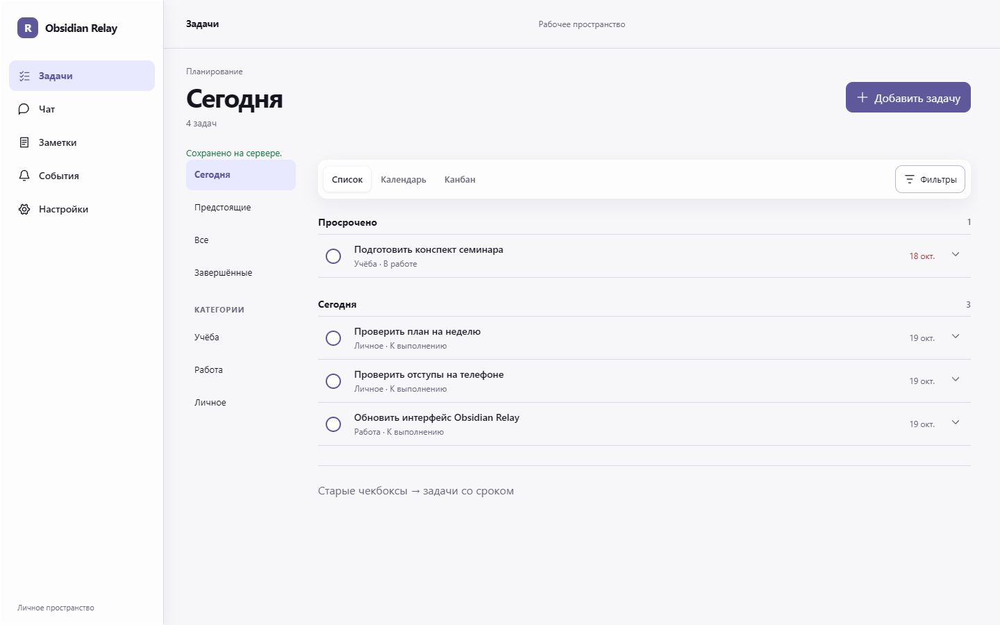

# UI/UX-рефакторинг Obsidian Relay

Дата: 19 октября 2026. Реализация находится в локальном рабочем дереве проекта.

## Результат

- Подписанная общая навигация: задачи, чат, заметки, события и настройки. На телефоне используется нижняя панель; история разговоров остаётся в чате.
- Задачи организованы по образцу Todoist: «Сегодня», «Предстоящие», «Все», «Завершённые», категории и отдельная секция просроченного. Компактная строка заменяет высокую карточку; подробности открываются в окне задачи.
- Редактор сохраняет обязательный срок, все три его типа, часовой пояс, категории, четыре приоритета, теги, ключевые слова и существующую защиту записей от конфликтов и повторов.
- Фильтры, сортировка и ручное обновление раскрываются по запросу. Список, календарь и канбан используют существующий API. На телефоне календарь представлен повесткой, канбан прокручивается внутри.
- Общая сетка и нейтральные поверхности, приглушённый фиолетовый акцент. Стеклянные навигация и панель видов используют CSS backdrop blur, прозрачный фон и светлую кромку. Новых зависимостей и WebGL нет.
- Окно задачи использует нативный modal dialog для блокировки всего фона; ошибки показываются внутри редактора, фокус возвращается к инициатору. Сохранены reduced-motion и fallback для отсутствия blur, добавлены правила forced-colors. Масштабирование страницы разрешено.

## Изменённые исходники

`packages/app/src/App.tsx`, `Icons.tsx`, `screens/Tasks.tsx`, `styles.css`, `packages/app/index.html`.

API, сервер, схема данных и хранилище этим рефакторингом не менялись. Чат продолжает открываться при новом входе; черновики и состояние смонтированных областей сохраняются при навигации.

## Происхождение дизайна

Дизайн создан в подтверждённом режиме Local Codex, проект `obsidian-relay-focus-glass-2026-10-19`. Успешный запуск: `f42954f9-71d1-4546-8510-0e45d7fcc9af`; его финальный статус — `succeeded`, набор исходников получен полностью, без усечения.

Сохранены [интерактивный HTML-прототип](focus-glass-prototype/index.html), [описание дизайн-системы](focus-glass-prototype/DESIGN.md) и [токены](focus-glass-prototype/brand-spec.md). Прототип содержит демонстрационные данные; в React перенесён только интерфейс с настоящими API.

После генерации при интеграции дополнительно исправлены модальность, отображение ошибок, возврат фокуса, перенос панели видов на 320 px и компоновка задач на планшете. Поэтому HTML-прототип отражает исходное направление, а финальная реализация — файлы React и снимки ниже.

Возвращённая OpenDesign ссылка Studio: `http://127.0.0.1:64426/projects/obsidian-relay-focus-glass-2026-10-19/conversations/3e7787f6-f63f-4c92-987b-4e50a1943b3a/files/index.html`. Во время финальной проверки временный сервер OpenDesign уже не работал; для просмотра сохранена локальная копия прототипа.

## Выполненные проверки

- `npm.cmd run build -w @relay/core` и `npm.cmd run build -w @relay/server` — успешно.
- `npm.cmd run build -w @relay/app` — успешно, включая TypeScript и PWA-сборку.
- `npm.cmd run typecheck` — успешно для всех трёх пакетов.
- `npm.cmd test` — 180 тестов успешно: 38 core и 142 server, без пропусков.
- `git diff --check -- packages/app` — успешно.

Браузерная проверка выполнялась на `127.0.0.1:8092` с отдельными SQLite-базой и vault в `data/focus-glass-qa/runtime`, без внешнего ИИ и Git-синхронизации.

Проверены создание задачи «до даты», создание «до времени», редактирование с переходом к «в указанное время», показ ошибки неверного часового пояса, завершение из строки и наличие задачи в завершённых, изменение статуса из канбана, календарь, доступ к заметкам и настройкам, сохранение черновика чата при переходах. Проверены Shift+Tab/Tab внутри окна, Escape и возврат фокуса; после создания фокус возвращается к кнопке добавления.

| Ширина | Ширина документа | Результат |
| --- | --- | --- |
| 320 px | 320 px | Общего горизонтального переполнения нет |
| 390 px | 390 px | Общего горизонтального переполнения нет |
| 768 px | 768 px | Разделы задач в горизонтальной строке, переполнения нет |
| 1440 px | 1440 px | Полная боковая навигация, переполнения нет |

При 320 px календарная повестка видима вместо сетки. Канбан имеет внутреннюю ширину прокрутки 958 px при доступных 286 px; документ остаётся шириной 320 px. Стекло в браузере: `blur(18px) saturate(1.16)`.

Reduced-motion, fallback без blur и forced-colors проверены по CSS; отдельная браузерная эмуляция этих режимов не выполнялась. Запросы к внешним ИИ, OCR и подключение к рабочему серверу в эту UI-проверку не входили.

## Снимки

[Мобильный интерфейс, 390 px](focus-glass-qa/tasks-mobile-390.png).

## Референсы

- [Todoist: Today](https://www.todoist.com/help/todoist/get-started/plan-your-day-with-the-today-view-UVUXaiSs).
- [Liquid Glass JS](https://github.com/dashersw/liquid-glass-js) — визуальный ориентир, библиотека не устанавливалась.
